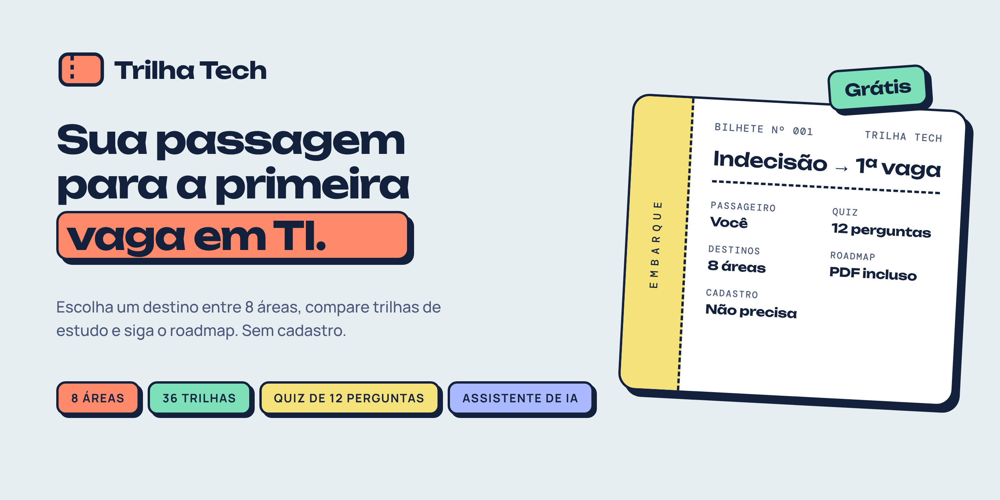
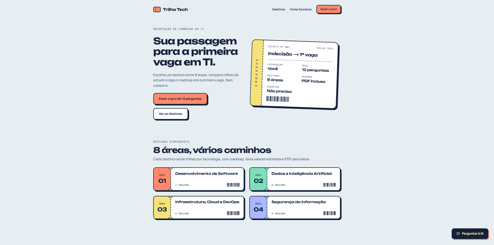
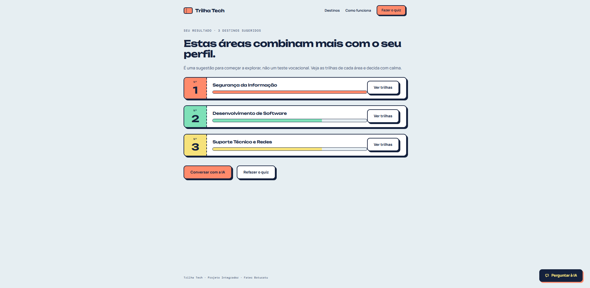
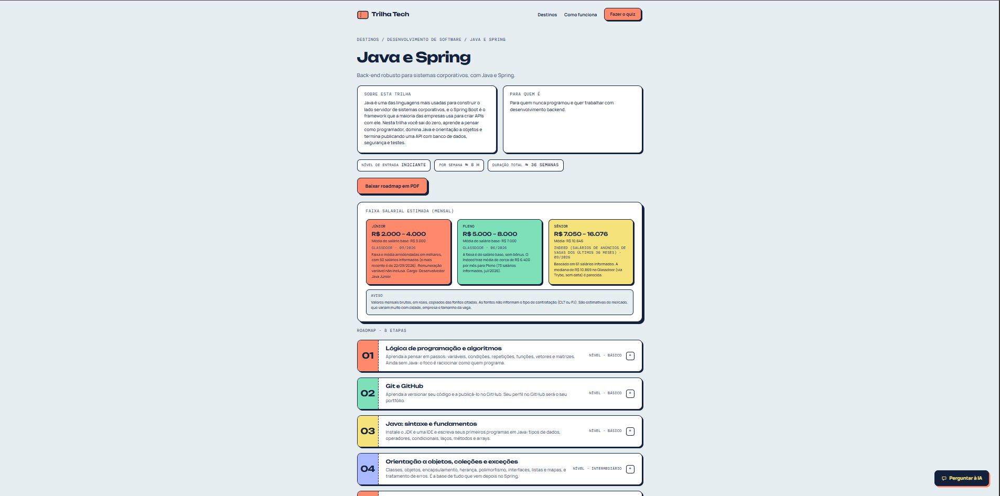
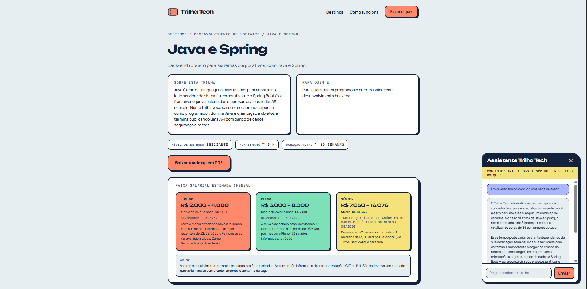
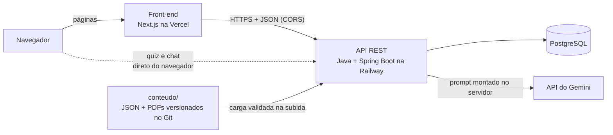

<div align="center">



<br>

**Plataforma web gratuita que ajuda quem está começando em TI a descobrir qual área seguir e a estudar com um roadmap claro, etapa por etapa.**

[](https://github.com/obrenoxs/trilha-tech/actions/workflows/ci.yml)


[**🚀 Acessar o site**](https://trilha-tech-two.vercel.app) ·
[**📖 Swagger da API**](https://trilha-tech-production.up.railway.app/swagger-ui.html) ·

</div>

---

## Por que o Trilha Tech existe

Quem começa em tecnologia costuma travar na primeira pergunta: **por onde eu começo?** Programação, dados, segurança, design, infraestrutura... Sem saber, a pessoa estuda de tudo um pouco e não avança.

O Trilha Tech resolve isso com a metáfora de uma **viagem de avião**: cada área de TI é um *destino*, cada trilha tem um *roadmap* e o seu *bilhete* começa em "indecisão" e termina na primeira vaga.

> Projeto Integrador da **Fatec Botucatu**, construído em grupo e publicado em produção.

## Veja em ação

<!-- Troque pelos prints reais do site no ar (veja docs/imagens/LEIAME.md) -->
<table>
  <tr>
    <td width="50%"><br><sub><b>Home:</b> o bilhete e as 8 áreas</sub></td>
    <td width="50%"><br><sub><b>Quiz:</b> 3 áreas para começar a explorar</sub></td>
  </tr>
  <tr>
    <td width="50%"><br><sub><b>Trilha:</b> etapas, recursos e faixa salarial com fonte</sub></td>
    <td width="50%"><br><sub><b>Assistente de IA:</b> sabe em qual página você está</sub></td>
  </tr>
</table>

## O que a plataforma oferece

| | |
|---|---|
| ✈️ **8 áreas e 36 trilhas** | Desenvolvimento de Software, Dados e IA, Infraestrutura/Cloud/DevOps, Segurança, Qualidade e Testes, Suporte e Redes, UX/UI Design, Gestão e Produtos de TI |
| 🗺️ **Roadmap em etapas** | Cada trilha tem etapas em ordem, projeto prático e recursos de estudo com tipo, idioma e se é grátis, pago ou a confirmar |
| 💰 **Faixa salarial estimada** | Júnior, pleno e sênior, **sempre com fonte e mês de referência** e aviso de que é estimativa |
| 📄 **Roadmap em PDF** | Baixe o roadmap de qualquer trilha |
| 🧭 **Quiz de 12 perguntas** | Opcional. Recomenda **áreas** (não vagas) como ponto de partida, não como teste vocacional |
| 🤖 **Assistente de IA** | Flutuante em todas as páginas e ciente do contexto: recebe a área/trilha em que você está |
| 🆓 **Grátis e sem cadastro** | Versão 1 sem login e sem coleta de dados pessoais |

Conteúdo atual: **8 áreas, 36 trilhas, 290 etapas, 539 recursos, 108 faixas salariais, 12 perguntas e 36 PDFs**, conferidos em 16/10/2026.

## Como funciona por dentro



Três ideias guiam o projeto:

1. **Conteúdo como código.** O catálogo vive em arquivos JSON versionados no Git, revisáveis em Pull Request e validados no CI. Na subida, a API lê, valida (todos os erros de uma vez) e sincroniza com o banco. Se algo estiver errado, ela nem sobe.
2. **A IA responde só com o que está no catálogo.** O prompt é montado **no servidor**, a partir do banco. O texto do navegador nunca vira instrução, e há quatro barreiras de uso (por visitante e globais) para proteger a cota sem exigir login.
3. **Fidelidade ao design.** Cada tela foi construída a partir do Figma e conferida lado a lado em desktop (1280 px) e mobile (390 px).

## Stack

| Camada | Tecnologias |
|---|---|
| **Front-end** | Next.js 16 (App Router), TypeScript estrito, Tailwind CSS 4, componentes de servidor com cache, fontes Unbounded, Manrope e DM Mono |
| **API** | Java 25, Spring Boot 4.1 (MVC, Data JPA, Bean Validation), PostgreSQL, Flyway, springdoc-openapi |
| **IA** | API do Gemini, atrás de uma interface própria (`ClienteIa`), então trocar de provedor é trocar uma classe |
| **Contrato** | Tipos do front gerados com `openapi-typescript` a partir do OpenAPI da API, sem DTO escrito à mão |
| **Testes** | Back: JUnit 5, Mockito, AssertJ, MockMvc e PostgreSQL real. Front: Vitest, Playwright (e2e) e verificação de acessibilidade com axe |
| **Entrega** | Docker multi-stage, GitHub Actions, Railway (API e banco) e Vercel (front) |
| **Design** | Figma (tokens, componentes e telas desktop e mobile) |

## Decisões que valem destacar

- **Chamadas direto do navegador para a API, sem proxy.** A API limita o uso do assistente por visitante pelo IP. Com um proxy, todo mundo pareceria o mesmo visitante.
- **Quiz sem estado no servidor.** O resultado é calculado por uma classe pura e testada (pontuação ponderada, top 3 e desempate determinístico) e guardado só no navegador do usuário.
- **Erros com formato único.** O front nunca mostra mensagem técnica: escolhe o texto pelo status HTTP (400, 404, 413, 429 com contagem regressiva, 503).
- **Acessibilidade desde o começo.** HTML semântico, foco visível, navegação por teclado, contraste e respeito a `prefers-reduced-motion`.
- **Segurança em camadas.** Validação de entrada, limite de tamanho de corpo, proteção contra *path traversal* no PDF, Actuator reduzido a `health`, segredos só em variáveis de ambiente e contêiner sem privilégios.

As justificativas completas estão em [`docs/decisoes-tecnicas.md`](docs/decisoes-tecnicas.md).

## Rodando localmente

**Pré-requisitos:** JDK 25, Node.js (LTS atual), PostgreSQL e Git.

**1. Back-end** (detalhes e variáveis em [`backend/README.md`](backend/README.md))

```bash
# crie o banco: CREATE DATABASE trilhatech_dev;
export DB_URL=jdbc:postgresql://localhost:5432/trilhatech_dev
export DB_USER=postgres
read -rs -p "Senha do Postgres: " DB_PASSWORD; export DB_PASSWORD

cd backend
./mvnw spring-boot:run        # Windows: .\mvnw.cmd spring-boot:run
```

A API sobe em `http://localhost:8080` e a documentação em `/swagger-ui.html`. Sem `GEMINI_API_KEY`, só o assistente fica indisponível (503).

**2. Front-end**

```bash
cd frontend
cp .env.example .env.local     # aponte NEXT_PUBLIC_API_URL para a sua API
npm install
npm run dev                    # http://localhost:3000
```

Se preferir não subir o back-end, use a API de produção em `NEXT_PUBLIC_API_URL`.

| Variável (front) | Descrição |
|---|---|
| `NEXT_PUBLIC_API_URL` | URL base da API |
| `NEXT_PUBLIC_SITE_URL` | URL pública do site (usada em canonical, Open Graph e sitemap) |

As variáveis `NEXT_PUBLIC_*` são embutidas no build: depois de alterar, faça um novo build/deploy.

## Qualidade e testes

```bash
# front-end (dentro de frontend/)
npm run lint && npm run typecheck && npm run test && npm run build
npm run e2e          # fluxos de ponta a ponta com Playwright
npm run gen:api      # regenera os tipos a partir do OpenAPI da API

# back-end (dentro de backend/)
./mvnw test          # unitários, sem banco
./mvnw verify        # inclui os de integração, com PostgreSQL real (banco *_test)
```

O CI roda em todo Pull Request: valida o conteúdo, testa o back-end com PostgreSQL de verdade, constrói a imagem Docker e confere se ela sobe e responde. O front tem um workflow próprio.

## Estrutura do repositório

```
trilha-tech/
├── frontend/      Next.js: páginas, componentes, quiz, assistente e testes e2e
├── backend/       API Spring Boot (README próprio)
├── conteudo/      Fonte de verdade: catálogo, trilhas, quiz e PDFs (JSON versionado)
├── docs/          Decisões técnicas e documentação do projeto
├── .github/       Workflows de CI
└── Dockerfile     Build da API em dois estágios
```

## Limitações conhecidas

- **Sem login na v1:** favoritos, painel de administração e contas ficaram fora do escopo.
- **Salários são estimativas** de mercado, sempre com fonte e mês, e não distinguem CLT de PJ.
- **Links de recursos** são conferidos manualmente (campo `verificadoEm`), sem verificação automática.
- **O assistente depende da cota gratuita** do provedor de IA: ao atingir o limite, ele fica indisponível e o resto do site continua funcionando.

## Equipe

Projeto Integrador da **Fatec Botucatu**.

| Integrantes | |
|---|---|
| **Breno Oliveira de Souza** | [@obrenoxs](https://github.com/obrenoxs) |
| Esdras | |
| Laura | |
| Lorena | |
| Salvador | |

---

<div align="center">
<sub>Feito com café, Figma e muitos <code>git commit</code>. Se o projeto te ajudou a escolher um caminho, deixe uma ⭐</sub>
</div>
