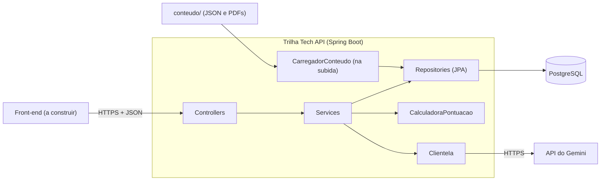
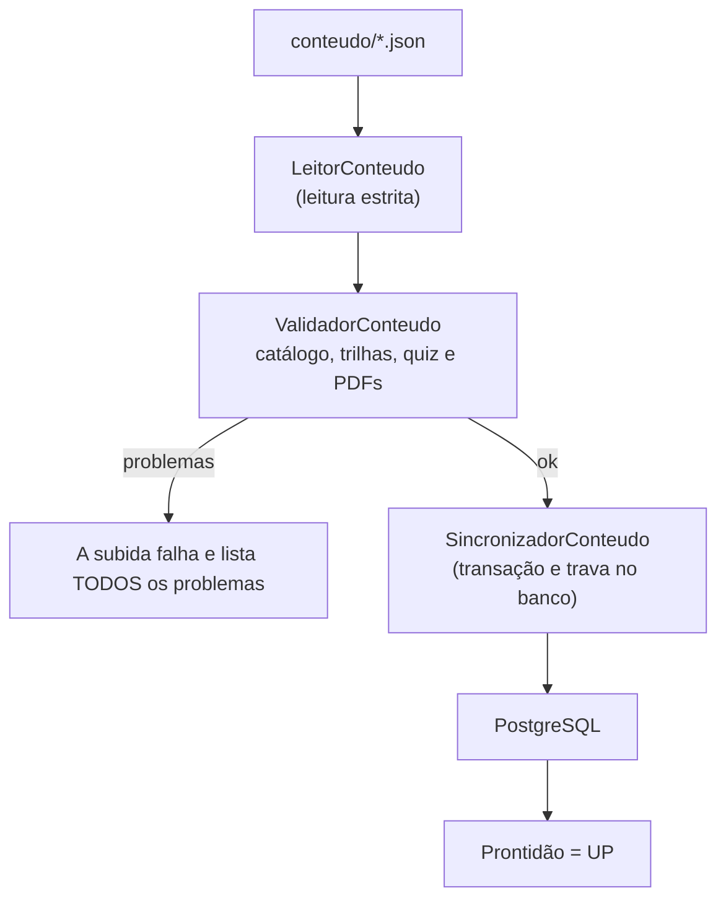
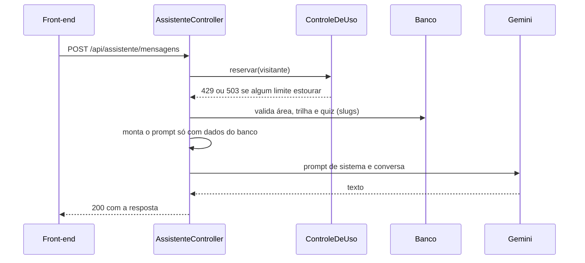

# Trilha Tech


Plataforma que ajuda pessoas iniciantes em TI a **escolher uma área** e a **seguir um roadmap de estudos**. Este repositório contém o **backend** (API REST em Java e Spring Boot) e o **conteúdo** que alimenta a plataforma.

- **API em produção:** https://trilha-tech-production.up.railway.app
- **Documentação interativa (Swagger UI):** https://trilha-tech-production.up.railway.app/swagger-ui.html

> A interface web ainda será construída sobre esta API. O contrato dela está estável e coberto por testes.

## Sumário

- [Sobre o projeto](#sobre-o-projeto)
- [Funcionalidades](#funcionalidades)
- [Tecnologias](#tecnologias)
- [Arquitetura](#arquitetura)
- [Como o conteúdo entra no sistema](#como-o-conteúdo-entra-no-sistema)
- [API](#api)
- [Quiz: como o resultado é calculado](#quiz-como-o-resultado-é-calculado)
- [Assistente de IA](#assistente-de-ia)
- [Segurança](#segurança)
- [Tratamento de erros](#tratamento-de-erros)
- [Banco de dados](#banco-de-dados)
- [Como rodar localmente](#como-rodar-localmente)
- [Testes](#testes)
- [CI/CD e deploy](#cicd-e-deploy)
- [Estrutura do repositório](#estrutura-do-repositório)
- [Decisões e limitações conhecidas](#decisões-e-limitações-conhecidas)
- [Autor](#autor)

## Sobre o projeto

Quem está começando em tecnologia costuma travar na primeira pergunta: *por onde eu começo?* O Trilha Tech responde com três peças:

1. **Um catálogo curado** de 8 áreas de TI e 36 trilhas, cada uma com roadmap em etapas, recursos de estudo (com idioma, tipo e se é gratuito, pago ou não confirmado) e faixas salariais estimadas, sempre com fonte e mês de referência.
2. **Um quiz de 12 perguntas** que sugere as 3 áreas mais indicadas, como ponto de partida e não como teste vocacional.
3. **Um assistente de IA** que responde dúvidas usando somente o conteúdo do catálogo.

Números do conteúdo atual: **8 áreas, 36 trilhas, 290 etapas, 539 recursos, 108 faixas salariais, 12 perguntas (48 alternativas) e 36 PDFs de roadmap**. Os dados foram conferidos em 16/10/2026.

## Funcionalidades

- Listagem das áreas e detalhe de cada uma, com as trilhas na ordem de estudo.
- Detalhe de uma trilha: etapas em ordem, recursos de cada etapa, projeto prático, três faixas salariais (júnior, pleno e sênior) e aviso sobre os salários.
- Download do roadmap de cada trilha em **PDF**.
- **Quiz** com pontuação ponderada, top 3 e critérios de desempate determinísticos.
- **Assistente de IA** (Gemini) com limites de uso por visitante e por dia, sem login.
- Documentação **OpenAPI/Swagger** gerada a partir do código.
- Health check de **vida e prontidão**, usado pela plataforma de deploy.

## Tecnologias

| Camada | Escolha |
|---|---|
| Linguagem e framework | Java 25, Spring Boot 4.1 (Spring MVC, Spring Data JPA, Bean Validation) |
| Banco de dados | PostgreSQL, com migrações Flyway (apenas estrutura) |
| Documentação da API | springdoc-openapi 3 (OpenAPI e Swagger UI) |
| IA | API do Gemini (modelo `gemini-3.5-flash-lite`), atrás de uma interface própria |
| Observabilidade | Spring Boot Actuator (somente `health`) |
| Testes | JUnit 5, Mockito, AssertJ, MockMvc, PostgreSQL real nos testes de integração |
| Build e empacotamento | Maven (wrapper), Docker multi-stage |
| CI/CD | GitHub Actions e Railway (deploy a partir do GitHub, com *Wait for CI*) |

Sem Lombok (DTOs e arquivos de conteúdo são *records*) e sem Spring Security: a API é pública e somente leitura, e os riscos são tratados em outras camadas (veja [Segurança](#segurança)).

## Arquitetura

Camadas clássicas (`controller` → `service` → `repository`), organizadas por **módulo** e por **conceito**:



Pacote base: `io.github.obrenoxs.trilhatech`

| Módulo | Responsabilidade |
|---|---|
| `conteudo` | Áreas e trilhas: entidades, consultas, DTOs, PDF |
| `quiz` | Perguntas, resultado e a calculadora de pontuação (classe pura, sem Spring) |
| `assistente` | Chat, cliente de IA (`ClienteIa` e `ClienteGemini`) e controle de uso |
| `carga` | Leitura, validação e sincronização do conteúdo com o banco |
| `compartilhado` | Tratamento de erros, configurações, filtros e o formato padrão de erro |

Princípios aplicados:

- **Inversão de dependência:** o resto do projeto conhece só a interface `ClienteIa`. Trocar de provedor de IA significa trocar uma classe.
- **Regras puras e testáveis:** pontuação, validadores, limitadores e escolha do IP não dependem de Spring nem de banco.
- **Dependências em uma direção:** `compartilhado` não importa nenhum outro módulo.
- **Sem N+1:** as listas aninhadas (etapas, recursos, alternativas) são buscadas em uma consulta e agrupadas em memória, ou com `join fetch`.

## Como o conteúdo entra no sistema

O conteúdo **não é digitado em um painel**: ele vive em arquivos JSON versionados no Git (`conteudo/`), revisáveis em Pull Request e validados pelo CI. Na subida, a aplicação lê, valida e sincroniza tudo com o banco.



- **Leitura estrita:** uma chave desconhecida em qualquer JSON derruba a carga, o que pega erro de digitação.
- **Validação acumulada:** em vez de parar no primeiro erro, todos os problemas saem juntos, com a trilha, a etapa e o campo, o que poupa ciclos de deploy.
- **Idempotente:** carregar duas vezes não duplica nada. As áreas são atualizadas pelo slug (o id se mantém), e trilhas, etapas, recursos e quiz são recriados.
- **Trava no banco:** `pg_advisory_xact_lock` impede duas instâncias de sincronizar ao mesmo tempo, o que acontece em um deploy com sobreposição.
- **PDF obrigatório:** se uma das 36 trilhas estiver sem PDF no pacote, a aplicação não sobe.
- **Prontidão só depois da carga:** a carga é um `ApplicationRunner`, e o Spring só marca a aplicação como pronta depois dele. A plataforma de deploy não manda tráfego para uma instância com o catálogo vazio.

Para alterar o conteúdo: edite os JSON, rode `python conteudo/ferramentas/validar.py` e abra um Pull Request. O CI repete a validação. O contrato dos arquivos está em [`conteudo/docs/contrato-roadmap.md`](conteudo/docs/contrato-roadmap.md).

## API

Base: `/api`. O identificador público de áreas e trilhas é o **slug**. Nenhuma resposta expõe ids internos.

| Método | Rota | Descrição | Respostas |
|---|---|---|---|
| GET | `/api/areas` | Lista as áreas, com a quantidade de trilhas | 200 |
| GET | `/api/areas/{slug}` | Detalha uma área e lista as trilhas dela | 200, 404 |
| GET | `/api/trilhas/{slug}` | Detalha uma trilha (etapas, recursos, faixas salariais) | 200, 404 |
| GET | `/api/trilhas/{slug}/pdf` | Baixa o roadmap em PDF | 200, 404 |
| GET | `/api/quiz` | Lista as 12 perguntas, sem áreas nem pontos | 200 |
| POST | `/api/quiz/resultado` | Calcula o top 3 a partir das 12 respostas | 200, 400, 413 |
| POST | `/api/assistente/mensagens` | Envia uma mensagem ao assistente | 200, 400, 413, 429, 503 |
| GET | `/actuator/health/liveness` e `/readiness` | Vida e prontidão | 200 ou 503 |
| GET | `/swagger-ui.html` e `/v3/api-docs` | Documentação | 200 |

**Exemplo: listar as áreas**

```bash
curl https://trilha-tech-production.up.railway.app/api/areas
```
```json
[
  {
    "slug": "dados-e-ia",
    "numero": "02",
    "nome": "Dados e Inteligência Artificial",
    "descricao": "...",
    "quantidadeTrilhas": 5
  }
]
```

**Exemplo: resultado do quiz.** O corpo leva as 12 respostas (abreviado abaixo). `pergunta` e `alternativa` são as **ordens** que vieram em `GET /api/quiz`, e não ids nem a posição na tela, porque o front-end embaralha as alternativas.

```json
{ "respostas": [ { "pergunta": 1, "alternativa": 3 }, { "pergunta": 2, "alternativa": 1 }, "... até a pergunta 12" ] }
```
```json
{
  "recomendacoes": [
    { "posicao": 1, "slug": "desenvolvimento-de-software", "nome": "Desenvolvimento de Software", "barra": 100 },
    { "posicao": 2, "slug": "dados-e-ia", "nome": "Dados e Inteligência Artificial", "barra": 75 },
    { "posicao": 3, "slug": "infraestrutura-cloud-devops", "nome": "Infraestrutura, Cloud e DevOps", "barra": 42 }
  ]
}
```

**Exemplo: assistente**

```bash
curl -X POST https://trilha-tech-production.up.railway.app/api/assistente/mensagens \
  -H "Content-Type: application/json" \
  -d '{"mensagem":"Quanto ganha uma pessoa júnior nessa trilha?","contexto":{"areaSlug":"desenvolvimento-de-software","trilhaSlug":"java-e-spring"}}'
```
```json
{ "resposta": "..." }
```
No PowerShell, o aninhamento de aspas atrapalha: use o *Try it out* do Swagger ou grave o corpo em um arquivo e envie com `--data-binary "@arquivo.json"`.

## Quiz: como o resultado é calculado

A regra mora em uma classe pura (`CalculadoraPontuacao`), coberta por testes:

1. Cada alternativa escolhida dá **+2** à área principal e **+1** à secundária.
2. O resultado são as **3 áreas com mais pontos**.
3. **Desempate**, nesta ordem: mais pontos, depois a área escolhida como principal em mais perguntas, depois a `ordemDesempate` fixa de cada área. A regra vale também para o 3º lugar.
4. A **barra** é relativa: a primeira área vale 100 e as outras são proporcionais aos pontos dela, arredondadas. Os pontos brutos nunca saem da API.

O quiz é **sem estado**: o servidor não guarda respostas nem resultado, e o front-end guarda o que precisar. `GET /api/quiz` não expõe as áreas nem os pontos de cada alternativa, para ninguém "dirigir" o resultado. As respostas são validadas contra o banco (uma por pergunta, só alternativas que existem), e todos os problemas voltam juntos em um 400.

## Assistente de IA



**Como o prompt é protegido**

- O prompt de sistema é montado **só no backend**, a partir do conteúdo **do banco**. O texto que o navegador manda nunca entra nele.
- O contexto da página chega como **slugs** (área, trilha e áreas do quiz), validados no banco. Um slug inexistente vira 400.
- O histórico (no máximo 6 mensagens) entra apenas como turnos da conversa, nunca como instrução. Falas do assistente no início do histórico são descartadas, e cada fala é truncada.
- As regras ficam no começo do prompt e um lembrete curto fecha o texto. O conteúdo do catálogo é limitado a 24 mil caracteres, e as regras nunca são cortadas.
- Nenhuma falha do provedor vira detalhe na resposta: o usuário vê sempre a mesma mensagem, e o motivo real vai só para o log.

**Limites de uso (sem login)**

Conferidos nesta ordem, da barreira mais barata para a mais cara, e só a última consome a cota de verdade:

| # | Barreira | Valor | Onde fica | Resposta |
|---|---|---|---|---|
| 1 | Por visitante, por minuto | 5 | Memória | 429 com `Retry-After: 60` |
| 2 | Por visitante, por hora | 30 | Memória | 429 com `Retry-After: 3600` |
| 3 | Global, por minuto | 12 | Memória | 503 |
| 4 | Global, por dia | 400 | PostgreSQL | 503 |

O teto diário é um contador no banco, incrementado com **uma única instrução SQL atômica** (`INSERT ... ON CONFLICT ... WHERE`), seguro mesmo com requisições simultâneas, e sobrevive a reinícios. O "dia" segue o fuso do Pacífico, o mesmo corte em que a cota do Google reinicia. Os 400 deixam folga sobre os 500 por dia da camada gratuita do modelo usado.

O IP do visitante vem do cabeçalho `X-Real-IP` (a plataforma o sobrescreve na borda), é validado (só caracteres de IP, tamanho limitado, sem consulta de DNS) e, se faltar ou for inválido, usa-se o endereço da conexão. O IP vive **só em memória**: não vai para banco nem para log.

## Segurança

| Risco | Como é tratado |
|---|---|
| Abuso do assistente e custo | Quatro barreiras de uso e uma chave de API sem faturamento ativado: o pior caso é o assistente ficar indisponível, e não uma cobrança |
| *Prompt injection* | Prompt só no servidor, histórico apenas como conversa, contexto validado no banco, lembrete final (veja acima) |
| Corpos gigantes | Filtro que recusa, antes de ler o corpo, requisições de `/api` acima de 100 KB (413) |
| *Path traversal* no PDF | O nome do arquivo é montado com o slug que veio **do banco**, nunca com o texto da URL |
| Entradas malformadas | Bean Validation com limites (tamanhos, padrões de slug, item nulo em lista) e JSON inválido tratado como 400 genérico |
| Vazamento de detalhes | Erros de formato fixo, sem mensagens de exceção, pilha ou dados internos |
| Segredos | Somente variáveis de ambiente. Chave de IA e senhas nunca vão ao Git nem a imagens Docker |
| Superfície do Actuator | Somente `health`, sem detalhes. `env`, `beans`, `heapdump` e similares respondem 404 (testado) |
| CORS | Origens permitidas configuráveis (`CORS_ORIGENS`) |
| Contêiner | Imagem multi-stage com usuário sem privilégios |

## Tratamento de erros

Todos os erros seguem um formato único, definido em um `@RestControllerAdvice`:

```json
{
  "timestamp": "2026-10-23T19:09:56.4836593",
  "status": 400,
  "error": "Bad Request",
  "message": "Requisição inválida",
  "errors": [
    { "message": "A alternativa 9 não existe na pergunta 1" },
    { "message": "A pergunta 1 foi respondida mais de uma vez" },
    { "message": "Falta responder a pergunta 2" }
  ],
  "path": "/api/quiz/resultado"
}
```

O campo `errors` só aparece quando há detalhes e, nas falhas de validação, traz `field` (por exemplo `respostas[0]`) e `message`.

| Status | Quando |
|---|---|
| 400 | Corpo inválido, respostas do quiz inconsistentes, contexto do chat inexistente |
| 404 | Área ou trilha inexistente |
| 413 | Corpo da requisição acima do limite |
| 429 | O visitante enviou mensagens demais (cabeçalho `Retry-After`) |
| 503 | Assistente indisponível: limite global ou diário, ou provedor de IA fora do ar |
| 500 | Erro inesperado, com mensagem fixa e a causa só no log |

## Banco de dados

| Migração | Conteúdo |
|---|---|
| `V1` | `area` e `trilha` (a ordem da trilha é única por área) |
| `V2` | `etapa`, `recurso` e `faixa_salarial`, com remoção em cascata a partir da trilha |
| `V3` | `pergunta` e `alternativa` (a área principal e a secundária nunca são a mesma, garantido por `CHECK`) |
| `V4` | `uso_assistente`, o contador diário do assistente (sem IP nem texto de conversa) |

- Chaves primárias `UUID` (`gen_random_uuid()`), textos como `TEXT` e enums gravados como texto.
- O Flyway cuida só da **estrutura**: o conteúdo vem dos arquivos. Uma migração aplicada nunca é editada.
- `ddl-auto: validate`: se uma entidade não bater com a tabela, a aplicação não sobe.
- `open-in-view: false`: nenhuma consulta preguiçosa escapa da camada de serviço.

## Como rodar localmente

**Pré-requisitos:** JDK 25, PostgreSQL e Git. Docker é opcional.

**1. Crie o banco**

```sql
CREATE DATABASE trilhatech_dev;
```

**2. Defina as variáveis de ambiente** (a senha é lida sem aparecer na tela)

PowerShell:
```powershell
$env:DB_URL = "jdbc:postgresql://localhost:5432/trilhatech_dev"
$env:DB_USER = "postgres"
$s = Read-Host "Senha do Postgres" -AsSecureString; $env:DB_PASSWORD = [System.Net.NetworkCredential]::new("", $s).Password
```

Bash:
```bash
export DB_URL=jdbc:postgresql://localhost:5432/trilhatech_dev
export DB_USER=postgres
read -rs -p "Senha do Postgres: " DB_PASSWORD; export DB_PASSWORD
```

**3. Suba a aplicação**

```bash
cd backend
./mvnw spring-boot:run        # no Windows: .\mvnw.cmd spring-boot:run
```

Na subida, o conteúdo é carregado (`Conteúdo carregado: 8 áreas e 36 trilhas`). Depois, abra http://localhost:8080/swagger-ui.html.

**Variáveis de ambiente**

| Variável | Obrigatória | Padrão | Descrição |
|---|---|---|---|
| `DB_URL` | Sim | | URL JDBC: `jdbc:postgresql://host:5432/banco` |
| `DB_USER` | Sim | | Usuário do banco |
| `DB_PASSWORD` | Sim | | Senha do banco |
| `GEMINI_API_KEY` | Não | vazia | Chave da API do Gemini. Sem ela, só o assistente responde 503 |
| `GEMINI_MODELO` | Não | `gemini-3.5-flash-lite` | Modelo usado pelo assistente |
| `CORS_ORIGENS` | Não | `http://localhost:3000,http://localhost:5173` | Origens permitidas, separadas por vírgula |
| `SWAGGER_HABILITADO` | Não | `true` | `false` desliga o Swagger e o `/v3/api-docs` |
| `PORT` | Não | `8080` | Porta HTTP (a Railway define sozinha) |

Os limites do assistente e do corpo das requisições ficam em `backend/src/main/resources/application.yml`.

**Pela imagem Docker** (na raiz do repositório, porque o build também lê a pasta `conteudo/`):

```bash
docker build -t trilha-tech-api .
docker run --rm -p 8080:8080 \
  -e DB_URL=jdbc:postgresql://host.docker.internal:5432/trilhatech_dev \
  -e DB_USER=postgres -e DB_PASSWORD \
  trilha-tech-api
```

## Testes

| Tipo | Sufixo | Banco | Comando | Quantidade |
|---|---|---|---|---|
| Unitários | `*Test` | Não | `./mvnw test` | 318 |
| Integração | `*IT` | PostgreSQL real | `./mvnw verify` | 89 |

*(Números de 23/10/2026.)*

**Unitários** (JUnit, Mockito e AssertJ) rodam em qualquer máquina, sem banco nem variável. Cobrem a calculadora de pontuação e seus desempates, o conversor de textos, todos os validadores (com dados quebrados de propósito, conferindo a mensagem exata e que os problemas saem juntos), os limitadores com relógio controlado, o escolhedor de IP com entradas hostis, o montador de prompt, os services (com Mockito), o tratador de erros e o filtro de tamanho do corpo.

**Integração** sobem o Spring completo contra um PostgreSQL de verdade. Provam as migrações e as restrições do banco, a carga e a sincronização (idempotência, atualização, remoção e a trava entre instâncias), o contador diário sob concorrência (40 requisições disputando 5 vagas), os endpoints de ponta a ponta com o conteúdo real (cada uma das 36 trilhas e cada PDF, byte a byte), o quiz comparado com a calculadora, o assistente com um cliente de IA falso (nenhuma chamada real), CORS, limites e erros, o contrato OpenAPI e a prontidão do health check.

**Para rodar os de integração**

```powershell
$s = Read-Host "Senha do Postgres" -AsSecureString; $env:TEST_DB_PASSWORD = [System.Net.NetworkCredential]::new("", $s).Password
cd backend
.\mvnw.cmd verify
```

Por padrão, usam `jdbc:postgresql://localhost:5432/trilhatech_test` e o usuário `postgres` (`TEST_DB_URL` e `TEST_DB_USER` mudam isso). Crie antes o banco vazio com `CREATE DATABASE trilhatech_test;`: o Flyway cria as tabelas.

**Trava de segurança:** os testes de integração **se recusam a rodar** em um banco cujo nome não termine em `_test`, tanto pela configuração quanto consultando `current_database()` antes de qualquer limpeza. Eles nunca tocam no banco de desenvolvimento.

## CI/CD e deploy

O workflow [`.github/workflows/ci.yml`](.github/workflows/ci.yml) roda em todo Pull Request e em todo push no `main`, com três jobs independentes:

| Job | O que faz |
|---|---|
| **Validar conteúdo** | Roda `conteudo/ferramentas/validar.py` (estrutura, hashes e equilíbrio do quiz) |
| **Testes do backend** | `./mvnw verify` com um PostgreSQL temporário como serviço (unitários e integração) |
| **Imagem Docker sobe e responde** | Constrói a imagem, sobe o contêiner, espera a prontidão e confere: 8 áreas, usuário sem privilégios, trilha, PDF, `/v3/api-docs` e o `/actuator/env` fechado |

**Produção (Railway)**

- O serviço da API é construído pelo `Dockerfile` da raiz, a partir do GitHub, com **Wait for CI** ligado: o deploy só sai depois do CI passar.
- O PostgreSQL é um serviço da própria Railway, acessado pela **rede privada** (`postgres.railway.internal`), sem acesso público.
- O *health check* da plataforma aponta para `/actuator/health/readiness`: a Railway só manda tráfego depois que a carga do conteúdo terminou.
- As variáveis de banco usam referências ao serviço do Postgres, então nenhuma senha é copiada:

```
DB_URL=jdbc:postgresql://postgres.railway.internal:5432/${{Postgres.PGDATABASE}}
DB_USER=${{Postgres.PGUSER}}
DB_PASSWORD=${{Postgres.PGPASSWORD}}
```

A URL do banco entregue pela Railway começa com `postgresql://`, e o Spring exige o prefixo `jdbc:`. Por isso a `DB_URL` é montada à mão.

## Estrutura do repositório

```
trilha-tech/
├── .github/workflows/ci.yml     CI: conteúdo, testes e imagem Docker
├── backend/                     API (Maven, Spring Boot)
│   ├── src/main/java/...        módulos: conteudo, quiz, assistente, carga, compartilhado
│   ├── src/main/resources/      application.yml e migrações Flyway (db/migration)
│   └── src/test/java/...        testes unitários (*Test) e de integração (*IT)
├── conteudo/                    fonte de verdade do conteúdo
│   ├── catalogo.json            áreas e índice de trilhas
│   ├── quiz.json                12 perguntas
│   ├── trilhas/<slug>.json      uma trilha por arquivo
│   ├── pdfs/                    36 PDFs de roadmap
│   ├── docs/contrato-roadmap.md contrato dos arquivos
│   └── ferramentas/validar.py   validação de qualidade (roda no CI)
├── docs/decisoes-tecnicas.md    decisões, mudanças de rota e riscos conhecidos
├── Dockerfile                   build em dois estágios
└── README.md
```

## Decisões e limitações conhecidas

As decisões de projeto, o que mudou durante a construção e os riscos estão em [`docs/decisoes-tecnicas.md`](docs/decisoes-tecnicas.md). Em resumo:

- **Sem login na v1.** Favoritos, painel de administração e contas ficam fora do escopo atual.
- **Salários são estimativas** de mercado, sempre com fonte e mês. Os dados não distinguem CLT de PJ.
- **Os links dos recursos** são conferidos manualmente (campo `verificadoEm`), e a validação automática não verifica se os links ainda respondem.
- **O limite por visitante** depende de a plataforma entregar o IP real no `X-Real-IP`. Isso foi testado contra IP forjado, mas ainda não com duas redes diferentes. Se a plataforma entregasse o mesmo IP a todos, o limite por visitante se comportaria como um limite global, e os tetos globais continuariam protegendo a cota.
- **O banco de produção** usa o usuário padrão da plataforma. A troca por um usuário restrito está prevista.
- **A camada gratuita do Gemini** tem cota e termos próprios. O assistente é desligado, sem afetar o resto do site, quando o limite é atingido.

## Autor

**Breno Oliveira de Souza** · [@obrenoxs](https://github.com/obrenoxs)

Projeto de portfólio, construído por fases, com foco em arquitetura em camadas, tratamento de erros, segurança, testes e entrega contínua.
